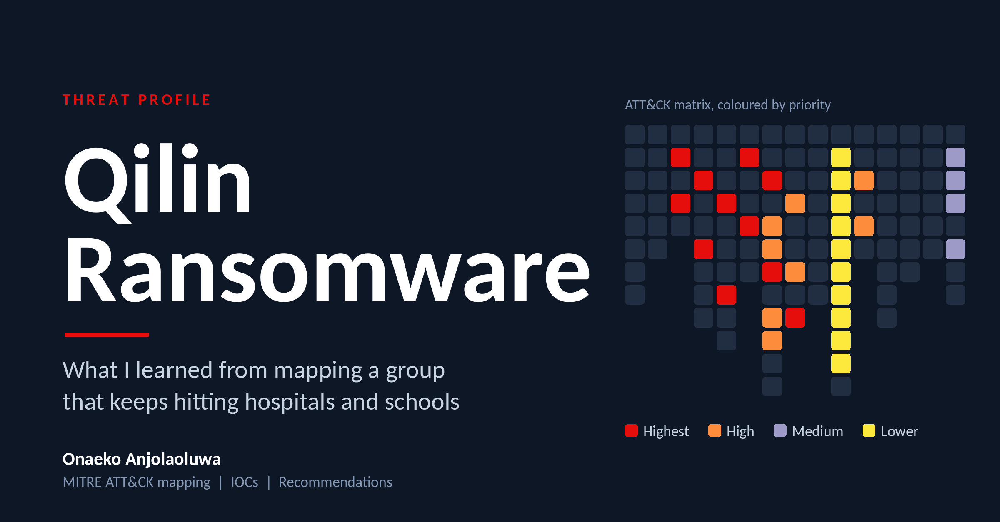
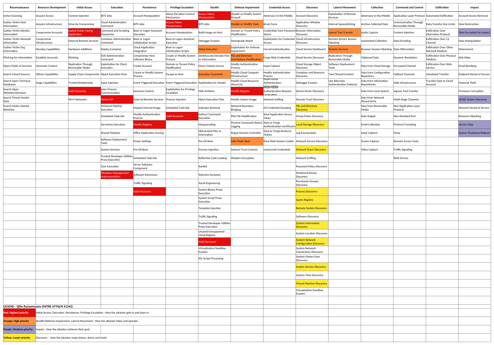
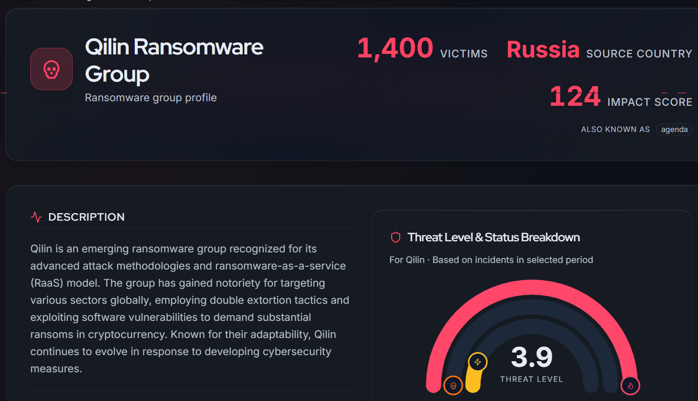
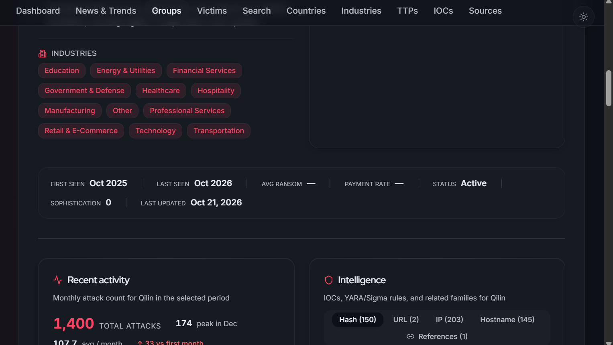

# Qilin Ransomware: Threat Profile

An individual threat intelligence research project on the Qilin (Agenda) ransomware group, focused on the education and healthcare sectors. Completed during my SOC Analyst internship at GiSOC. I carried out the research, the MITRE ATT&CK mapping, the IOC collection, and the report.

## Summary
Qilin is a ransomware-as-a-service (RaaS) group active since 2022. Affiliates break into a network, steal data, encrypt Windows, Linux, and VMware ESXi systems, and threaten to publish the data if the victim does not pay (double extortion). In 2026 it was among the most active groups, ranking first on leak-site listings for five months in a row (January to May) with between 101 and 131 victims a month. Victims include universities, schools, hospitals, and manufacturers.

**Main finding:** Many Qilin intrusions begin with something basic, such as an exposed VPN, a remote access tool, or a stolen password. For schools and hospitals, fixing access control, patching, and backups gives the biggest return.

## Objectives
- Build a visual threat profile of Qilin by mapping its tactics and techniques in MITRE ATT&CK Navigator, colour-coded by priority
- Collect and tabulate IOCs (file hashes, IP addresses, and hostnames)
- Summarize recent activity and statistics, especially against education and healthcare
- Recommend practical mitigations a defender can act on

**Scope:** Desk research using public sources up to October 2026. I did not run any malware or test any system. The IOCs come from SOCRadar and were not verified in a lab, so they should be checked against threat intelligence tools before being blocked.

## Methodology
1. Read the Qilin profile on SOCRadar's Ransomware Intelligence page and noted the techniques it lists.
2. Created an Enterprise layer in ATT&CK Navigator (v19) and selected Qilin (software S1242).
3. Added two techniques that MITRE's mapping did not include but that other reporting supports: Valid Accounts (T1078) and Remote Services (T1021, including RDP).
4. Colour-coded the matrix by attack phase. The earlier a technique can be disrupted in the attack chain, the higher its priority. Impact techniques are ranked Medium because they happen last and are best prevented by blocking earlier stages. Exported the matrix to Excel with a legend.
5. Collected 14 IOCs from SOCRadar, then gathered statistics and recent incidents from vendor and news reports and cross-checked where sources overlapped.

## How Qilin operates
Qilin is a Russian-speaking RaaS operation. The core team provides the ransomware and a leak site, and affiliates carry out attacks and share the ransom. Reports describe this typical chain:

- **Entry:** exposed services (VPN flaws, ConnectWise ScreenConnect), phishing including fake ScreenConnect installers, and stolen or leaked credentials
- **Foothold and spread:** AnyDesk and ScreenConnect, RDP, PsExec and WMI, with Mimikatz used to steal credentials
- **Defense evasion:** disabling security tools (including vulnerable-driver abuse), clearing logs, and deleting shadow copies
- **Exfiltration and impact:** data copied out (for example with WinSCP) before encryption, backups targeted (Veeam CVE-2023-27532 was exploited), then encryption and a ransom note

## MITRE ATT&CK mapping
| Priority | Tactics | Techniques in my layer |
|---|---|---|
| Red (highest) | Initial Access, Execution, Persistence, Privilege Escalation | Exploit Public-Facing Application, Valid Accounts (T1078), Native API, Windows Management Instrumentation, Modify Registry, Access Token Manipulation |
| Orange (high) | Stealth / Defense Impairment, Lateral Movement | Disable or Modify Tools, File and Directory Permissions Modification, Safe Mode Boot, Delay Execution, Execution Guardrails, Lateral Tool Transfer, Remote Services (T1021) |
| Purple (medium) | Impact | Data Encrypted for Impact, Inhibit System Recovery, Service Stop, System Shutdown/Reboot |
| Yellow (lower) | Discovery | File and Directory Discovery, Network Share Discovery, Remote System Discovery, Process Discovery, Query Registry, System Information, System Network Configuration, System Service and Virtual Machine Discovery, Local Storage Discovery |

\* Added by me from additional reporting; not in MITRE's S1242 list. Techniques under more than one tactic keep the colour of the earlier attack phase. No Reconnaissance, Resource Development, or Collection techniques appear in MITRE's mapping for Qilin.

## Recent attacks
- **Universities:** Université Libre de Bruxelles was listed on Qilin's leak portal on 9 August 2026. Musashino University (Japan) had ransomware on its systems on 15 June 2026 and Qilin claimed the theft on 29 June. The University of Mannheim (Germany) was claimed on 18 February 2026.
- **Healthcare:** Qilin attacked Synnovis, a pathology provider for London hospitals, on 3 June 2024. Over 10,000 appointments were disrupted, and about 170 cases of patient harm were recorded.
- **Other:** Qilin was linked to the shutdown of about 30 Asahi brewery factories in Japan.

## Attacker statistics
| 2026 (leak-site victims) | Jan | Feb | Mar | Apr | May | Jan to May |
|---|---|---|---|---|---|---|
| Qilin victims claimed | 107 | 104 | 131 (record) | 103 | 101 | 546 |

- Qilin was the top group for five straight months. In June 2026 a rival group, The Gentlemen, overtook it with 94 victims.
- Black Kite counted 1,358 Qilin victims between April 2025 and March 2026, up 443% on the previous 12 months. In 2025 manufacturing was its most attacked sector (about 23% of listings).
- Leak-site numbers only show victims who were listed, so the real total is higher, and claims are not always verified.

## Indicators of compromise
All indicators are defanged. Remove the brackets only when using them in security tools, and verify them first, because indicators can be stale or reused.

View the 14 IOCs

| # | Category | Indicator | Type |
|---|---|---|---|
| 1 | Hash | `ba4d58f2c5903776fe47c92a0ec3297cc7b9c8fa16b3bf5f40b46242e7092b46` | SHA256 |
| 2 | Hash | `b9bba02d18bacc4bc8d9e4f70657d381568075590cc9d0e7590327d854224b32` | SHA256 |
| 3 | Hash | `98dd757e1c1fa8b5605bda892aa0b82ebefa1f07` | SHA1 |
| 4 | Hash | `b97812a2e6be54e725defbab88357fa2` | MD5 |
| 5 | IP address | `196.188.76[.]254` | IPv4 |
| 6 | IP address | `138.207.174[.]248` | IPv4 |
| 7 | IP address | `150.107.31[.]194` | IPv4 |
| 8 | IP address | `193.41.206[.]176` | IPv4 |
| 9 | IP address | `146.70.41[.]178` | IPv4 |
| 10 | Hostname | `solopodvip-my[.]xyz` | Domain |
| 11 | Hostname | `outpointsozp[.]shop` | Domain |
| 12 | Hostname | `apple-online[.]shop` | Domain |
| 13 | Hostname | `confirm-signal[.]site` | Domain |
| 14 | Hostname | `group-teneta[.]online` | Domain |

Source: SOCRadar Qilin intelligence data.

Related vulnerabilities reported in other analyses of Qilin intrusions: CVE-2023-27532 (Veeam Backup & Replication), CVE-2024-1708 (ConnectWise ScreenConnect), and CVE-2026-50751 (Check Point VPN).

## Mitigations
| Recommendation | What it counters |
|---|---|
| Patch internet-facing systems fast (VPN, ScreenConnect, Veeam) and remove anything not needed | Exploit Public-Facing Application |
| Enforce MFA on VPN, email, remote access, and admin accounts, and monitor for leaked credentials | Valid Accounts |
| Allow only approved remote tools and block RDP from the internet | Remote Services |
| Keep backups safe: 3-2-1 rule, one offline or immutable copy, separate credentials, tested restores | Inhibit System Recovery, Data Encrypted for Impact |
| Segment the network and protect ESXi and vCenter management behind MFA | Lateral Tool Transfer, ESXi encryption |
| Use EDR with tamper protection, block vulnerable drivers, and restrict credential dumping from LSASS | Disable or Modify Tools, Access Token Manipulation |
| Alert on shadow-copy deletion, safe-mode reboots, mass service stops, and large outbound transfers | Safe Mode Boot, Service Stop, data exfiltration |
| Send logs off the host and prepare a tested incident response plan | Faster detection, log clearing |

For schools and hospitals, I would put MFA, backups, and patching first, because these are cheap compared with the cost of downtime. In healthcare, delayed systems can directly harm patients.

## Conclusion
Qilin is a mature and fast-growing RaaS group that regularly targets education and healthcare. Its techniques span the whole attack chain, but the entry points are often simple ones: unpatched edge devices, remote tools, and stolen passwords. Mapping the group in ATT&CK Navigator shows where defenders can break the chain early, which is why I ranked the early stages highest. The IOCs can feed detection rules, but they age quickly, so continuous monitoring and strong basic security matter more than any single indicator.

## Lessons learned
- MITRE's mapping for a group is a starting point. Other reporting can fill gaps, as long as additions are labelled.
- Prioritizing by where in the attack chain a technique can be disrupted makes a mapping more useful to defenders.
- Public statistics need caution, because leak-site counts only show listed victims.

## Skills demonstrated
Threat actor research, MITRE ATT&CK Navigator mapping, IOC collection and defanging, cross-source verification, threat intelligence report writing, defensive recommendations.

## Screenshots

### SOCRadar group profile

### SOCRadar targeted industries and available IOCs

## Sources
SOCRadar Ransomware Intelligence (Qilin profile); MITRE ATT&CK (Qilin, S1242) and ATT&CK Navigator; Proven Data, CyberFlorida, Picus Security, Darktrace, and Sophos analyses; Breachsense monthly ransomware reports (January to May 2026); Barracuda; Black Kite; RansomNews; MOXFIVE; TechNadu; Infosecurity Magazine (Synnovis); SOCRadar and DeXpose victim pages.

> Desk research from public sources only. No malware was run and no systems were tested.
